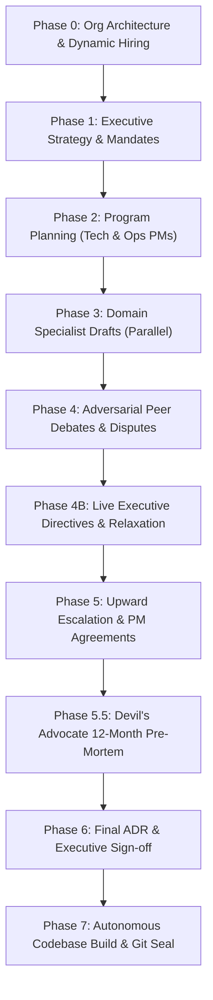

# 🏛️ The Boardroom — Autonomous Executive Multi-Agent Swarm

> **An autonomous multi-agent corporate organization that simulates an entire C-suite, program management office, and autonomous software engineering squad.**  
> Give it a high-stakes enterprise directive. Watch a 10+ agent hierarchy debate, cross-audit budgets, execute adversarial pre-mortems, synthesize an authoritative Architecture Decision Record (ADR), and autonomously write, test, and seal production code.

---

## 📸 Visual Showcase

### The 3D Interactive Boardroom (Live Agent Debates, Targeted Callouts & Binding Compromise)
*Agents seated across executive, managerial, and domain specialist desks. Active cross-examination highlights targets, grievances trigger escalation lines to management, and binding compromises resolve architectural stalemates.*


* **Top Red Alert Banner**: `⚡ Formal Grievance Filed: Cost Auditor escalated Cloud Architect to Management!`
* **Targeted Confrontation**: Real-time beacon highlighting `🎯 TARGETED BY DATA PIPELINE LEAD` directly over the Cloud Architect desk.
* **Active Speech Bubble**: Live question bubble `ASKING @CloudArchitect` during Phase 4 cross-agent debate.
* **Binding Compromise Arrows**: Glowing green decision arrows delivering the managerial arbitration verdict directly to the executive desk.
* **Red Team Desk (Left Window)**: The **Devil's Advocate** conducts adversarial pre-mortems to expose catastrophic failure vectors before sign-off.
* **Hierarchical Reporting Lines**: Executive oversight (purple), technical reporting (cyan), governance auditing (amber), and grievance escalation (red).
* **Real-Time Governance Dials**: Live tracking of estimated monthly spend, zero-trust statutory score, and SLA uptime projections.

---

### 👥 Agent Capabilities & Operational Powers Matrix

| Agent / Role | Hierarchy & Department | Core Capabilities & OS Powers | Specific Real-World Actions Executed |
| :--- | :--- | :--- | :--- |
| **👨‍💼 Head of PMO** | **Executive Tier**<br>*(Center Executive Desk)* | • Org Architecture & Sizing<br>• Executive Strategy Framing<br>• Final ADR Authoring<br>• PDF Dossier Sign-off | • Classifies challenge complexity (`Low`, `Medium`, `High`, `Critical`).<br>• Dynamically commissions domain specialists in Phase 0.<br>• Synthesizes the authoritative Architecture Decision Record (ADR) in Phase 6.<br>• Mediates live executive directives and budget relaxations. |
| **👨‍💻 Engineering PM** | **Management Tier**<br>*(Tech Manager Desk)* | • Technical Governance<br>• Workstream Chartering<br>• Technical Arbitration<br>• Release Gate Enforcement | • Drafts technical charters for Cloud Architect and QA Lead.<br>• Adjudicates architectural impasses during Phase 4 disputes.<br>• Issues binding technical compromises to ensure sub-50ms P99 SLAs.<br>• Gates code generation until all engineering criteria pass. |
| **👩‍💼 Ops & Finance PM** | **Management Tier**<br>*(Ops Manager Desk)* | • Financial & Governance Auditing<br>• Risk Envelope Enforcement<br>• Grievance Adjudication<br>• Cost Compromise Enactment | • Sets strict OpEx budget caps (e.g., \$3.5M ceiling).<br>• Adjudicates formal grievances filed by Cost Auditor or Security Officer.<br>• Enforces binding compromises between security latency and cost ceilings.<br>• Audits mathematical compliance across all proposals. |
| **🏗️ Cloud Architect** | **Domain Specialist**<br>*(Specialist Desk 1)* | • Multi-Region Topology Design<br>• Replication Lag Modeling<br>• `search_web` RFC Lookups<br>• Infrastructure Sizing | • Designs active-active multi-region cloud topologies.<br>• Models P99 database replication lag and partition tolerance.<br>• Performs live web searches for cloud provider pricing and API benchmarks.<br>• Defends architecture against Cost Auditor and Security Officer audits. |
| **💰 Cost Auditor** | **Governance Specialist**<br>*(Specialist Desk 2)* | • Mathematical Budget Auditing<br>• Unit Economics Modeling<br>• Grievance Filing Trigger<br>• OpEx Drift Prevention | • Audits cloud compute, storage, and egress line items mathematically.<br>• Files formal grievance alerts when peer proposals breach budget caps.<br>• Models spot instance vs reserved instance savings matrices.<br>• Escalates ungrounded estimates to Operations & Finance PM. |
| **🛡️ Security Officer** | **Governance Specialist**<br>*(Specialist Desk 3)* | • Zero-Trust Framework Design<br>• Compliance Mapping<br>• Cryptographic Auditing<br>• Threat Surface Analysis | • Architectures mTLS, OAuth2/OIDC, and token-bucket rate limiters.<br>• Maps statutory controls to PCI-DSS Level 1 and SOC2 Type II standards.<br>• Challenges low-latency proposals that sacrifice cryptographic verification.<br>• Formulates security guardrails and idempotency keys. |
| **🧪 QA & Reliability Lead** | **Domain Specialist**<br>*(Specialist Desk 4)* | • Chaos Engineering Strategy<br>• P99 SLA Verification Proofs<br>• Production-Scale Criteria<br>• Failure Mode Modeling | • Formulates synthetic load and chaos injection test matrices.<br>• Mandates production-scale readiness proofs before ADR sign-off.<br>• Models graceful degradation and circuit-breaker thresholds under failover. |
| **🔴 Devil's Advocate** | **Red Team Tier**<br>*(Left Window Desk)* | • Adversarial 12-Mo Pre-Mortem<br>• Catastrophic Failure Simulation<br>• Worst-Case Vector Analysis<br>• Epistemic Stress-Testing | • Conducts Phase 5.5 adversarial pre-mortem simulation.<br>• Models worst-case failure scenarios (e.g. cascading failover, latency explosion).<br>• Exposes operational blindspots and hidden assumptions before executive approval. |
| **💻 Senior Backend SWE** | **Engineering Squad**<br>*(Phase 7 Sandbox)* | • `write_file` / `read_file`<br>• Production Code Synthesis<br>• Self-Healing Bug Repairs<br>• Thread-Safety & Idempotency | • Writes production Python services (`src/service.py`) in isolated sandboxes.<br>• Implements cryptographic hashing, token buckets, and database locking.<br>• Ingests SDET test failure stack traces, diagnoses root causes, and fixes code. |
| **🧪 SDET Automation Lead** | **Engineering Squad**<br>*(Phase 7 Sandbox)* | • `run_command` Terminal Subprocess<br>• Automated Test Authoring<br>• Exit Code & Trace Parsing<br>• Self-Healing Driver | • Authors comprehensive automated unit tests (`tests/test_service.py`).<br>• Executes shell test commands (`python3 -m unittest` / `pytest`).<br>• Parses exit codes, assertion errors, and tracebacks to drive the repair loop. |
| **🚀 DevOps / SRE Lead** | **Engineering Squad**<br>*(Phase 7 Sandbox)* | • `init_git_repo`<br>• Docker Containerization<br>• Repository Sealing<br>• Environment Manifests | • Generates production `Dockerfile` and `docker-compose.yml` specs.<br>• Initializes Git repositories, configures agent identity, and seals commits.<br>• Validates container entrypoints and environment variable templates. |

---

## 🛠️ Deep Capabilities & Real-World Actions (What Can The Boardroom Do?)

The Boardroom is not just a conversational chatbot; it is an **autonomous software development and executive governance agent swarm equipped with real operating system capabilities, networking tools, and runtime test runners.**

Below is an exhaustive breakdown of what the application autonomously executes:

### 1. Autonomous Software Engineering & Code Generation
* **Scaffolds Complete Multi-Tier Architectures**: Rather than outputting detached code snippets, the dynamically commissioned Engineering Squad generates full repositories inside an isolated sandbox (`generated_repos/<project_slug>`).
* **Multi-Role Specialization**:
  * **Software Development Manager (SDM)**: Scaffolds directory layout, dependency manifests (`requirements.txt`), and architecture documentation (`README.md`).
  * **Senior Backend SWE**: Writes production service logic with thread-safety, transaction locks, and idempotency guarantees.
  * **Frontend / Client SWE**: Implements client SDKs, REST controllers, or CLI test drivers.
  * **DevOps / SRE Lead**: Generates production container definitions (`Dockerfile`, `docker-compose.yml`) and environment templates.
* **Real Disk Operations**: Files are directly written, read, and structured on the actual host filesystem with directory traversal security protections (`write_file`, `read_file`, `list_files`).

### 2. Autonomous Unit Testing & Self-Healing Loop
* **Dynamic Test Suite Authoring**: The **SDET Automation Engineer** analyzes the generated implementation and writes rigorous unit and integration test suites (`tests/test_service.py`).
* **Real Subprocess Execution (`run_command`)**: The swarm executes the test suite using actual shell commands (`python3 -m unittest` or `pytest`) inside the isolated workspace.
* **Automated Failure Analysis**: Captures return codes, `stdout`, and `stderr` execution traces.
* **Autonomous Self-Healing Repair Cycle**:
  1. If any test fails (exit code $\ne 0$ or assertion error), the failure log is immediately captured and fed back into the Senior SWE.
  2. The Senior SWE inspects the stack trace, diagnoses the root cause, modifies the source code, and issues a fix.
  3. The SDET re-executes the test suite automatically.
  4. The loop repeats until all tests pass with an exit code of `0`.

### 3. HTTP Requests, Live Web Search & External API Integration
* **Asynchronous HTTP Networking**: Equipped with an asynchronous HTTP engine (`httpx.AsyncClient`) for network calls, external service probing, and webhook dispatches.
* **Live Web Intelligence (`search_web`)**: Autonomously performs real-time queries (via DuckDuckGo API and engineering fallbacks) to retrieve current RFCs, security standards (PCI-DSS, SOC2, HIPAA), cloud pricing benchmarks, and API documentation.
* **API Validation & Probing**: Capable of sending HTTP requests (GET, POST, PUT, DELETE) to test live APIs, mock payment gateway handshakes, or verify service endpoints.

### 4. Autonomous Git Version Control & Repository Sealing
* **Automated Repository Initialization**: Automatically runs `git init` inside the project sandbox upon test completion.
* **Audit-Proof Commit Logging**: Configures the swarm committer identity (`swarm@autonomous-pmo.internal`), stages all newly created files (`git add .`), and crafts a descriptive Git commit hash (`feat: autonomous implementation`).

### 5. Dynamic Organizational Hiring & Workstation Provisioning
* **Phase 0 Complexity Classification**: The Head of PMO analyzes directive complexity (`Low`, `Medium`, `High`, `Critical`).
* **On-Demand Specialist Commissioning**: Dynamically hires domain-specific specialists tailored to the directive (e.g. Cloud Architect, Database Specialist, Performance Engineer, Security Officer, Cost Auditor, Regulatory Compliance Auditor, QA Lead).
* **3D Workstation Allocation**: Vacant desks in the 3D office automatically illuminate and seat agents as commission charters are signed.

### 6. Adversarial Cross-Agent Debates & Epistemic Verification
* **Epistemic Constitution**: Strict statement tagging enforced across all deliberations (`[REQUIREMENT]`, `[FACT]`, `[ESTIMATE]`, `[PROPOSAL]`, `[UNKNOWN]`).
* **Targeted Cross-Examinations**: Agents identify and challenge flaws in peer proposals (e.g., Cost Auditor auditing Cloud Architect's cloud spend against budget caps).
* **Formal Grievance Escalation**: Unsubstantiated claims or budget violations trigger red grievance alerts and escalate the dispute to management.
* **Binding Managerial Arbitration**: Engineering PM and Ops PM issue binding compromises to resolve deadlocks.

### 7. Adversarial 12-Month Pre-Mortem (Devil's Advocate)
* **Dedicated Red Team Desk**: Seated at the office window, the **Devil's Advocate** runs a simulated 12-month post-launch failure analysis.
* **Exposes Catastrophic Blindspots**: Uncovers latency spikes under peak load, security authorization handshakes exceeding SLAs, and OpEx budget blowouts before executive sign-off.

### 8. Real-Time 3D Interactive Boardroom & Visual Telemetry
* **Isometric Visual Office**: High-fidelity interactive floorplan featuring executive pod, managerial desk, specialist desks, and red team desk.
* **Dynamic Neon Reporting Lines**: Real-time visual vectors illustrating executive oversight (purple), technical reporting (cyan), governance tracking (amber), and active escalations (red).
* **Speech Bubbles & Camera Tracking**: Smooth pan and zoom (50% to 200%) focusing on active speaking agents.
* **Live KPI Dashboard**: Instant tracking of estimated monthly spend, zero-trust statutory score, spot savings, and SLA projections.

### 9. Dual-Inference Engine with Resilience & Rate-Limit Backoff
* **100% Offline Local Mode**: Integrates directly with LM Studio or Ollama (`http://127.0.0.1:1234/v1`) with zero external data transmission.
* **Cloud Multi-Streaming (OpenRouter)**: Supports cutting-edge cloud models including 100% Free Tier options (`google/gemma-4-31b-it:free`, `google/gemma-4-26b-a4b-it:free`).
* **Automatic 429 Exponential Backoff & Fallback**: Enforces intelligent concurrency throttling (2 parallel requests for free tier), auto-retries on HTTP 429 with exponential backoff (5s, 10s, 15s), and dynamically falls back to alternate models if upstream capacity is strained.

### 10. Audit-Ready Executive PDF Dossier Generation
* **Single-Click Compilation**: One click on "Executive PDF" renders a multi-page, publication-grade ReportLab Platypus PDF containing:
  * Executive Quality & Governance Scorecard (mathematical reconciliation, zero-trust rating, test status, git commit).
  * Authoritative Architecture Decision Record (ADR).
  * Complete Swarm Deliberation Transcript with internal reasoning chains.
  * Full Source Code Inventory with syntax-formatted code files.

---

## ⚡ The 8-Phase Governance Lifecycle



1. **Phase 0 (Org Architecture & Hiring)**: Head of PMO classifies complexity (`Low`, `Medium`, `High`, `Critical`) and dynamically commissions domain specialists.
2. **Phase 1 (Executive Strategy)**: Establishes hard financial ceilings, SLA targets, and statutory data residency constraints.
3. **Phase 2 (Program Planning)**: Tech PM and Ops PM issue formal workstream charters and release gate criteria.
4. **Phase 3 (Specialist Drafts)**: Cloud Architect, Cost Auditor, Security Officer, QA Lead, Data Engineer, and DevOps Lead draft independent proposals.
5. **Phase 4 (Cross-Agent Debates)**: Specialists audit and attack each other's proposals. Formal grievances trigger arbitration hearings.
6. **Phase 4B (Executive Directives)**: Human leadership can interject binding directives or grant budget relaxations mid-flight.
7. **Phase 5 (Upward Escalation)**: PMs reconcile disputes into binding Tier 2 agreements.
8. **Phase 5.5 (Devil's Advocate Pre-Mortem)**: Red team simulates a 12-month post-deployment failure scenario to expose hidden failure vectors.
9. **Phase 6 (Final ADR Sign-Off)**: Head of PMO synthesizes an authoritative Architecture Decision Record.
10. **Phase 7 (Autonomous Codebase Build)**:
    * **SDM Lead**: Scaffolds repository architecture (`README.md`, `requirements.txt`).
    * **Backend SWE**: Writes production Python service logic with thread-safety and idempotency.
    * **Client SWE**: Builds client controllers and CLI test drivers.
    * **SDET Lead**: Implements automated unit test suites (`tests/test_service.py`) and executes self-healing verification runs.
    * **DevOps SRE**: Containerizes with `Dockerfile` and seals the initial Git commit.

---

## 📄 Audit-Ready Executive PDF Dossier

Clicking **"Executive PDF"** in the top navigation bar compiles the entire initiative into a publication-grade ReportLab Platypus PDF containing:

1. **Executive Quality & Governance Scorecard**: Epistemic grounding rating, mathematical budget reconciliation, zero-trust rating, unit test status, and git commit hash.
2. **Authoritative Architecture Decision Record (ADR)**: Full context, decision rationale, and compliance guarantees.
3. **Complete Swarm Deliberation Transcript**: Every agent speech, debate clash, pre-mortem simulation, and managerial ruling.
4. **Autonomous Codebase Architecture**: Directory hierarchy, component inventory matrix, and syntax-styled source code listings.

---

## 🚀 Quickstart & Setup

### 1. Clone & Install
```bash
git clone https://github.com/kvai9826/the-boardroom.git
cd the-boardroom
pip install -r requirements.txt
```

### 2. Start The Boardroom Server
```bash
python3 -m uvicorn app:app --host 127.0.0.1 --port 8000
```
Open your browser to: **`http://127.0.0.1:8000`**

---

## ⚙️ Model Inference Options

The Boardroom supports two flexible execution backends:

* **Local Private Mode (LM Studio / Ollama)**: Run 100% offline at `http://127.0.0.1:1234/v1` with zero telemetry or data leakage. Compatible with Gemma 4, DeepSeek R1, Llama 3, or any local GGUF/MLX model.
* **Cloud Speed Mode (OpenRouter)**: Multi-stream parallel execution using cloud models (including **100% Free Tier Gemma 4** models such as `google/gemma-4-31b-it:free` and `google/gemma-4-26b-a4b-it:free`).

---

## 📁 Repository Structure

```
├── app.py                  # FastAPI application, WebSocket hub, and PDF export router
├── swarm_engine.py         # Autonomous multi-tier reasoning engine & governance state machine
├── config.py               # Agent personas, prompt templates, and model tier specifications
├── agentic_tools.py        # Sandboxed repository manager, code generator, and command runner
├── pdf_exporter.py         # ReportLab Platypus PDF generator (scorecard, transcript, codebase)
├── static/
│   ├── index.html          # Clean C-suite single-page application & responsive layout
│   ├── app.js              # Real-time WebSocket listener, dynamic hiring, and room renderer
│   ├── style.css           # Executive dark/light styling and animation system
│   └── dolls/              # 3D isometric workstation and character overlays
├── docs/
│   └── images/             # Showcase screenshots for GitHub documentation
├── requirements.txt        # Production dependencies (FastAPI, ReportLab, httpx, etc.)
└── README.md               # Project documentation and architectural overview
```

---

## 🛡️ License

This project is licensed under the MIT License — see the [LICENSE](LICENSE) file for details.
