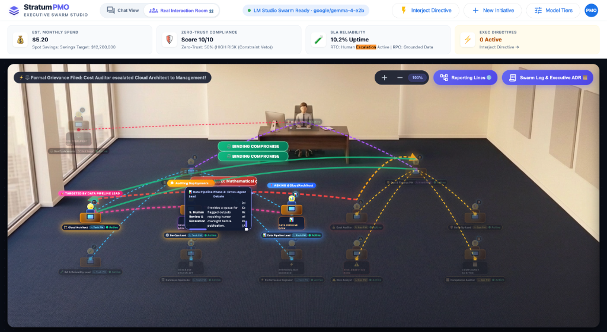
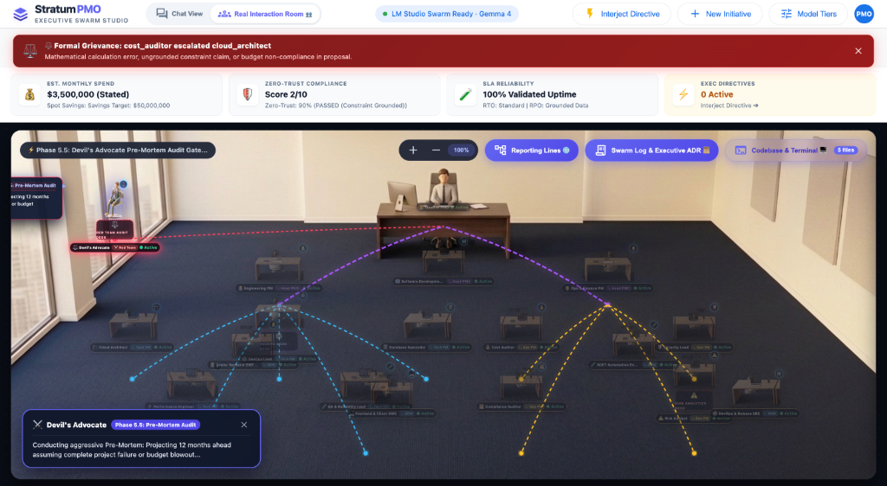
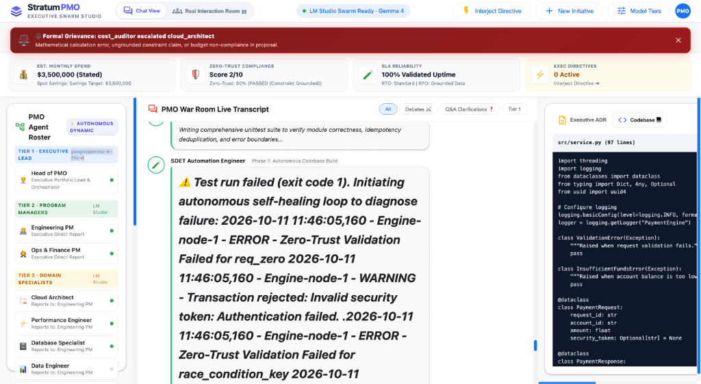
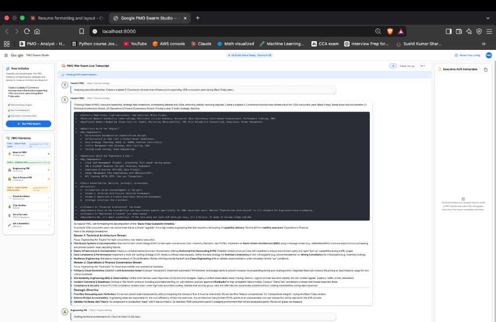
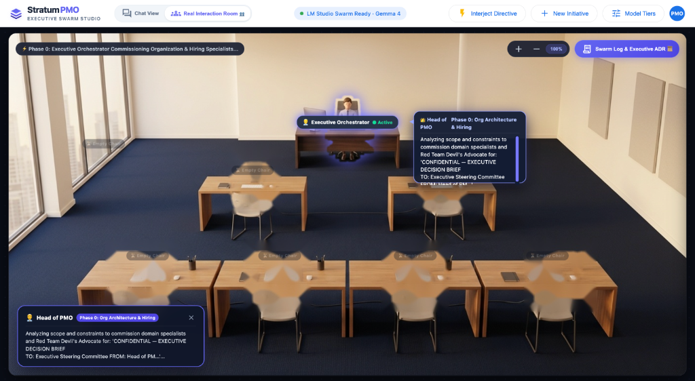
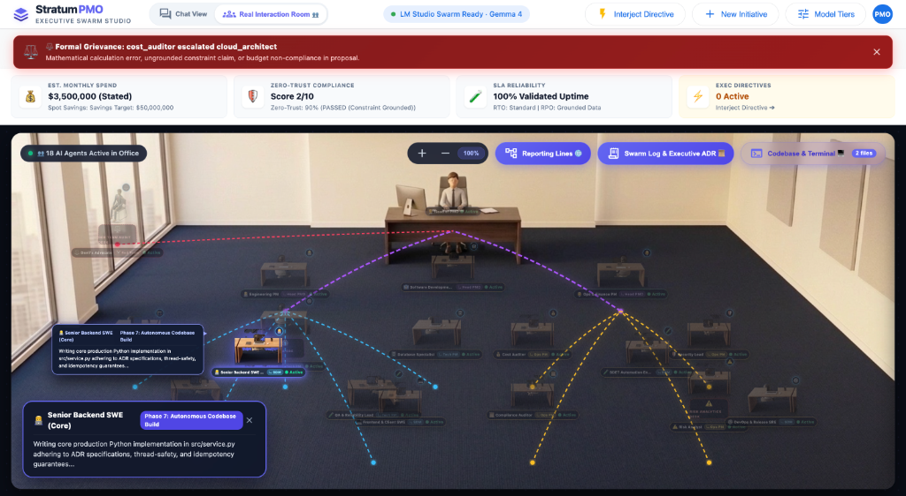
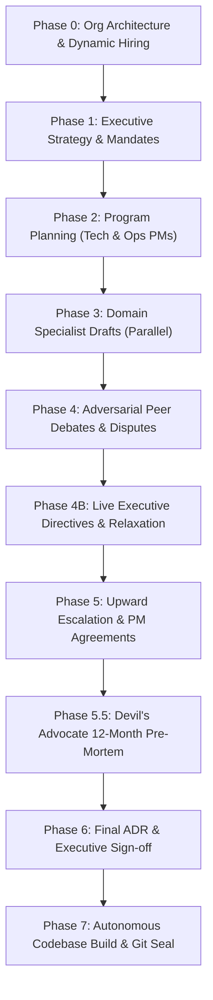

# 🏛️ The Boardroom — Autonomous Executive Multi-Agent Swarm

> **An autonomous multi-agent corporate organization that simulates an entire C-suite, program management office, and autonomous software engineering squad.**  
> Give it a high-stakes enterprise directive. Watch a 10+ agent hierarchy debate, cross-audit budgets, execute adversarial pre-mortems, synthesize an authoritative Architecture Decision Record (ADR), and autonomously write, test, and seal production code.

---

## 📸 Visual Showcase & System Tour

### 1. The 3D Interactive Boardroom (Live Agent Debates, Targeted Callouts & Binding Compromise)
*Agents seated across executive, managerial, and domain specialist desks. Active cross-examination highlights targets, grievances trigger escalation lines to management, and binding compromises resolve architectural stalemates.*



* **Top Red Alert Banner**: `⚡ Formal Grievance Filed: Cost Auditor escalated Cloud Architect to Management!`
* **Targeted Confrontation**: Real-time beacon highlighting `🎯 TARGETED BY DATA PIPELINE LEAD` directly over the Cloud Architect desk.
* **Active Speech Bubble**: Live question bubble `ASKING @CloudArchitect` during Phase 4 cross-agent debate.
* **Binding Compromise Arrows**: Glowing green decision arrows delivering the managerial arbitration verdict directly to the executive desk.
* **Red Team Desk (Left Window)**: The **Devil's Advocate** conducts adversarial pre-mortems to expose catastrophic failure vectors before sign-off.

---

### 2. Formal Grievance Escalation & Hierarchical Reporting Lines
*When an agent detects a budget miscalculation or ungrounded claim, they escalate the peer directly to leadership.*



* **Escalation Notification**: Mathematical calculation error and budget non-compliance filed against specialist proposals.
* **Multi-Color Reporting Lines**:
  * **Purple lines**: Executive oversight from Head of PMO to Program Managers.
  * **Cyan lines**: Technical reporting lines linking Engineering PM to Cloud Architect, QA Lead, and Data Leads.
  * **Amber lines**: Governance reporting lines linking Ops PM to Cost Auditor, Security Officer, and Risk Analyst.
  * **Red dashed lines**: Active escalation path from specialist directly to the managerial pod.
* **Real-Time Governance Dials**: Live tracking of estimated monthly spend, zero-trust statutory score, and SLA uptime projections.

---

### 3. Phase 7: Autonomous Codebase Build & Self-Healing Test Loop
*Following ADR sign-off, the dynamically commissioned Software Engineering Squad writes code into an isolated sandbox, detects unit test failures, and executes an autonomous self-healing fix.*



* **Autonomous Self-Healing Loop**: SDET Automation Engineer detects an exit code 1 failure (`Zero-Trust Validation Failed`), reads runtime logs, and executes an autonomous self-healing fix loop.
* **Split-Pane Code Explorer**: Live display of `src/service.py` being written, inspected, and executed in real time.
* **Dynamic Roster**: Shows the commissioned organizational hierarchy on the left with live status indicators.

---

### 4. Live War Room Deliberations & Real-Time ADR Synthesis
*The split-screen deliberation feed captures multi-turn epistemic debates alongside live Markdown architecture decision blueprints.*



* **Epistemic Constitution**: Agents strictly categorize every claim as `[REQUIREMENT]`, `[FACT]`, `[ESTIMATE]`, `[PROPOSAL]`, or `[UNKNOWN]`.
* **Deep Reasoning Traces**: Collapsible internal monologue blocks expose agent calculations and chain-of-thought before formal speeches.
* **Instant ADR Generation**: The synthesized Architecture Decision Record updates dynamically as consensus is forged.

---

### 5. Phase 0: Dynamic Organizational Hiring & Workstation Scaling
*The Head of PMO assesses challenge complexity and dynamically commissions domain specialists, automatically provisioning new office workstations.*



* **Dynamic Staffing Roster**: Rather than running a static team, the orchestrator hires specialized leads tailored to the mandate (e.g. Data Pipeline Lead, FinOps Auditor, Distributed Systems Architect).
* **Workstation Allocation**: Empty desks dynamically illuminate and seat agents as commission charters are signed.

---

### 6. Active Agent Speech Hotspot & Workstation Zoom
*The camera tracks individual workstations as specialists speak, displaying live phase tags and speech popups.*



* **Workstation Speech Bubble**: Shows the Senior Backend SWE actively writing production Python implementation with thread synchronization and idempotency guarantees.
* **Interactive Pan & Zoom**: Real-time zoom from 50% to 200% across the 3D boardroom floorplan to inspect any agent's live deliberations.

---

## ⚡ The 8-Phase Governance Lifecycle



1. **Phase 0 (Org Architecture & Hiring)**: Head of PMO classifies complexity (`Low`, `Medium`, `High`, `Critical`) and dynamically commissions domain specialists.
2. **Phase 1 (Executive Strategy)**: Establishes hard financial ceilings, SLA targets, and statutory data residency constraints.
3. **Phase 2 (Program Planning)**: Tech PM and Ops PM issue formal workstream charters and release gate criteria.
4. **Phase 3 (Specialist Drafts)**: Cloud Architect, Cost Auditor, Security Officer, QA Lead, Data Engineer, and DevOps Lead draft independent proposals.
5. **Phase 4 (Cross-Agent Debates)**: Specialists audit and attack each other's proposals. Formal grievances trigger arbitration hearings.
6. **Phase 4B (Executive Directives)**: Human leadership can interject binding directives or grant budget relaxations mid-flight.
7. **Phase 5 (Upward Escalation)**: PMs reconcile disputes into binding Tier 2 agreements.
8. **Phase 5.5 (Devil's Advocate Pre-Mortem)**: Red team simulates a 12-month post-deployment failure scenario to expose hidden failure vectors.
9. **Phase 6 (Final ADR Sign-Off)**: Head of PMO synthesizes an authoritative Architecture Decision Record.
10. **Phase 7 (Autonomous Codebase Build)**:
    * **SDM Lead**: Scaffolds repository architecture (`README.md`, `requirements.txt`).
    * **Backend SWE**: Writes production Python service logic with thread-safety and idempotency.
    * **Client SWE**: Builds client controllers and CLI test drivers.
    * **SDET Lead**: Implements automated unit test suites (`tests/test_service.py`) and executes self-healing verification runs.
    * **DevOps SRE**: Containerizes with `Dockerfile` and seals the initial Git commit.

---

## 📄 Audit-Ready Executive PDF Dossier

Clicking **"Executive PDF"** in the top navigation bar compiles the entire initiative into a publication-grade ReportLab Platypus PDF containing:

1. **Executive Quality & Governance Scorecard**: Epistemic grounding rating, mathematical budget reconciliation, zero-trust rating, unit test status, and git commit hash.
2. **Authoritative Architecture Decision Record (ADR)**: Full context, decision rationale, and compliance guarantees.
3. **Complete Swarm Deliberation Transcript**: Every agent speech, debate clash, pre-mortem simulation, and managerial ruling.
4. **Autonomous Codebase Architecture**: Directory hierarchy, component inventory matrix, and syntax-styled source code listings.

---

## 🚀 Quickstart & Setup

### 1. Clone & Install
```bash
git clone https://github.com/your-username/the-boardroom.git
cd the-boardroom
pip install -r requirements.txt
```

### 2. Start The Boardroom Server
```bash
python3 -m uvicorn app:app --host 127.0.0.1 --port 8000
```
Open your browser to: **`http://127.0.0.1:8000`**

---

## ⚙️ Model Inference Options

The Boardroom supports two flexible execution backends:

* **Local Private Mode (LM Studio / Ollama)**: Run 100% offline at `http://127.0.0.1:1234/v1` with zero telemetry or data leakage. Compatible with Gemma 4, DeepSeek R1, Llama 3, or any local GGUF/MLX model.
* **Cloud Speed Mode (OpenRouter)**: Multi-stream parallel execution using cloud models (including **100% Free Tier Gemma 4** models such as `google/gemma-4-31b-it:free` and `google/gemma-4-26b-a4b-it:free`).

---

## 📁 Repository Structure

```
├── app.py                  # FastAPI application, WebSocket hub, and PDF export router
├── swarm_engine.py         # Autonomous multi-tier reasoning engine & governance state machine
├── config.py               # Agent personas, prompt templates, and model tier specifications
├── agentic_tools.py        # Sandboxed repository manager, code generator, and command runner
├── pdf_exporter.py         # ReportLab Platypus PDF generator (scorecard, transcript, codebase)
├── static/
│   ├── index.html          # Clean C-suite single-page application & responsive layout
│   ├── app.js              # Real-time WebSocket listener, dynamic hiring, and room renderer
│   ├── style.css           # Executive dark/light styling and animation system
│   └── dolls/              # 3D isometric workstation and character overlays
├── docs/
│   └── images/             # Showcase screenshots for GitHub documentation
├── requirements.txt        # Production dependencies (FastAPI, ReportLab, httpx, etc.)
└── README.md               # Project documentation and architectural overview
```

---

## 🛡️ License

This project is licensed under the MIT License — see the [LICENSE](LICENSE) file for details.
